# Integrum — Mini Project Progress Review

> **From Problem Definition ‚Üí System Architecture ‚Üí Database ‚Üí Working Backend Modules**

---

## 1. What am I building?

**Integrum** is an integrated student success platform combining academic management, productivity, career development, analytics, and AI intelligence around a unified student profile.

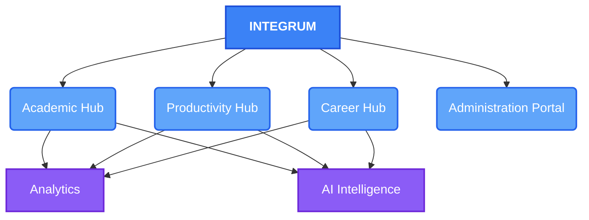

---

## 2. Why am I building it?

Currently, students experience extreme workflow fragmentation. The objective is to bring these disjointed tools into one unified student platform.

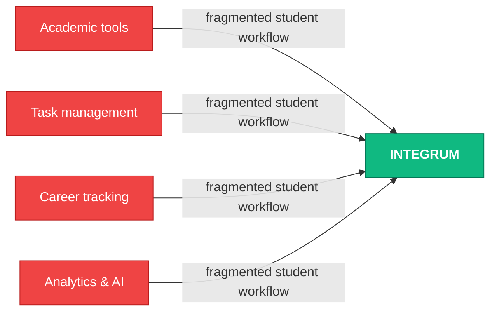

---

## 3. What have I designed?

Before writing code, I established a robust technical foundation to ensure the system scales elegantly.

### Core Domain Relationships
The domain model enforces ownership: student-specific data belongs to the appropriate student context.

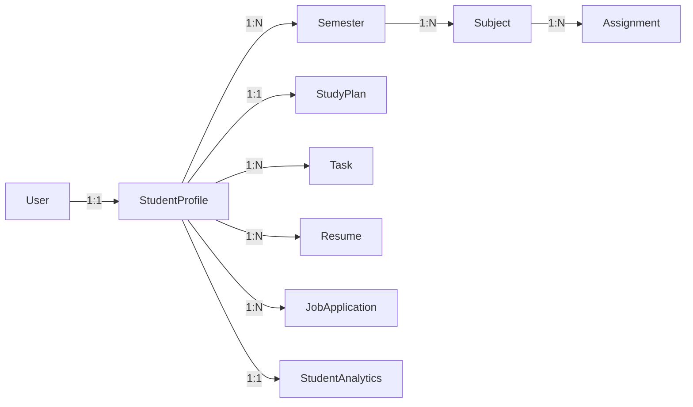

### System Architecture
A layered architecture where HTTP requests, business logic, and database access are strictly decoupled.

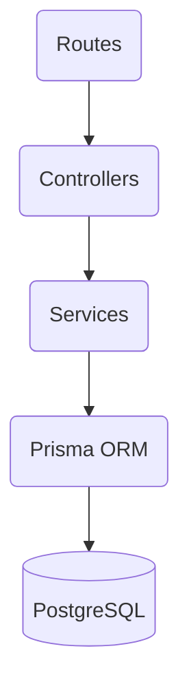

* **Routes** — endpoint mapping and middleware
* **Controllers** — HTTP request/response handling
* **Services** — business logic
* **Prisma** — data-access/ORM layer
* **PostgreSQL** — persistence

---

## 4. What have we actually implemented?

The design is no longer just conceptual documentation. 

### 4.1 Database Infrastructure
The schema has been successfully migrated to a local PostgreSQL database, establishing the real table structure (15 models, 9 enums).

### 4.2 Identity & Access

**Status:** ‚úÖ Complete

The Identity & Access module provides secure authentication, authorization, and session management.

#### Implemented Components

| Component | Status | Key functionality |
|---|---|---|
| Registration | ‚úÖ | Transactional account creation with automatic default semester assignment |
| Login | ‚úÖ | Secure credential verification |
| JWT Access Tokens | ‚úÖ | Secure API access via Bearer tokens |
| Refresh Token Lifecycle | ‚úÖ | Secure rotation via `HttpOnly` cookie |
| Logout | ‚úÖ | Securely clearing session cookies |
| RBAC | ‚úÖ | Role-based authorization controls |
| Validation & Error Handling | ‚úÖ | Graceful handling of duplicate emails (409 Conflict) and bad inputs (400 Bad Request) |

#### Working Software
- [x] Registration
- [x] Login
- [x] Protected API access (`/users/me`)
- [x] Token refresh
- [x] Logout
- [x] Validation & Error Handling

#### Verification
- [x] CRUD testing
- [x] Validation testing
- [x] Security testing (Auth/RBAC)
- [x] Invalid-resource handling

### 4.3 Academic Hub

**Status:** ‚úÖ Complete

The Academic Hub provides the core ownership hierarchy and academic management tools for the student.

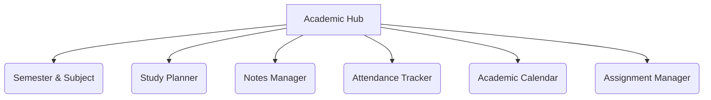

#### Implemented Components

| Component | Status | Key functionality |
|---|---|---|
| Semester Management | ‚úÖ | CRUD + ownership |
| Subject Management | ‚úÖ | CRUD + semester ownership |
| Assignment Manager | ‚úÖ | CRUD + subject ownership |
| Study Planner | ‚úÖ | CRUD + progress tracking |
| Notes Manager | ‚úÖ | CRUD + tags and file metadata |
| Attendance Tracker | ‚úÖ | Daily logging + percentage calculation |
| Academic Calendar | ‚úÖ | Event creation + timeline mapping |

#### Working Software
- [x] Creating Semesters, Subjects, and Assignments with strict data isolation
- [x] Managing Study Plans and generating progress
- [x] Storing Notes with metadata
- [x] Tracking Subject Attendance
- [x] Managing Calendar Events

#### Verification
- [x] CRUD testing
- [x] Validation testing
- [x] Cross-user isolation
- [x] Invalid-resource handling
- [x] Regression testing

### 4.4 Productivity Hub

**Status:** ‚úÖ Complete

The Productivity Hub focuses on immediate actionable items and schedule management for the student.

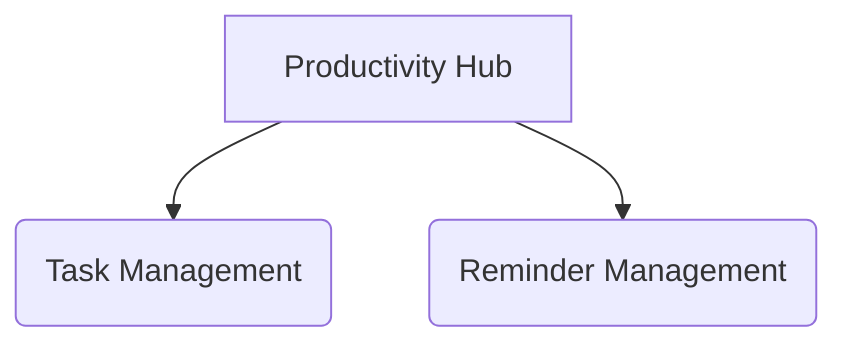

#### Implemented Components

| Component | Status | Key functionality |
|---|---|---|
| Task Management | ‚úÖ | CRUD + ownership + status tracking |
| Reminder Management | ‚úÖ | CRUD + ownership + trigger scheduling |

#### Working Software
- [x] Creating, updating, and fetching Tasks while verifying cross-user data isolation
- [x] Creating, updating, and fetching Reminders while verifying cross-user data isolation

#### Verification
- [x] CRUD testing
- [x] Validation testing
- [x] Cross-user isolation
- [x] Invalid-resource handling

### 4.5 Career Hub

**Status:** ‚úÖ Complete

The Career Hub manages professional development artifacts and job applications.

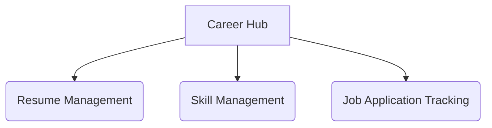

#### Implemented Components

| Component | Status | Key functionality |
|---|---|---|
| Resume Management | ‚úÖ | Versioning, ATS scoring, feedback |
| Skill Management | ‚úÖ | Tracking technical and soft skills |
| Job Application Tracking | ‚úÖ | Application status, notes, pipeline |

#### Working Software
- [x] Creating, updating, and retrieving Resumes (including automatic version creation)
- [x] Creating, updating, and retrieving Skills with predefined categories
- [x] Creating, updating, and retrieving Job Applications with status tracking

#### Verification
- [x] CRUD testing
- [x] Validation testing
- [x] Cross-user isolation
- [x] Invalid-resource handling

### 4.6 Analytics Hub

**Status:** ‚úÖ Complete

The Analytics Hub aggregates and analyzes data across the Academic, Productivity, and Career Hubs.

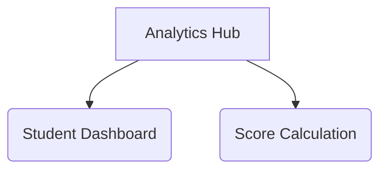

#### Implemented Components

| Component | Status | Key functionality |
|---|---|---|
| Student Dashboard | ‚úÖ | Core metrics aggregation across modules |
| Score Calculation | ‚úÖ | Multi-dimensional student performance score |

#### Working Software
- [x] Initial aggregate endpoints that compile existing database data
- [x] Cross-module calculations for assignments, attendance, tasks, and applications

### 4.7 AI Intelligence Hub

**Status:** ‚úÖ Foundation & Study Plan Complete (Future slices planned)

The AI Intelligence Hub integrates language models to assist with learning and career development through AI-driven insights. While the core provider layer and study plan generation are complete, capabilities like Resume ATS analysis and Notes summarization remain future vertical slices.

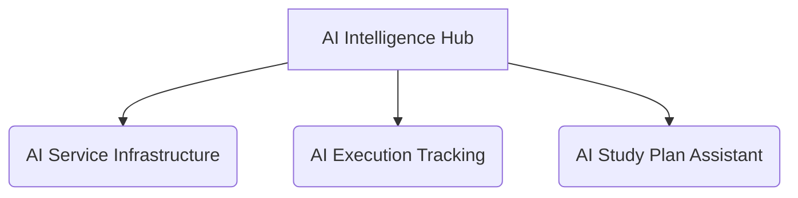

#### Implemented Components

| Component | Status | Key functionality |
|---|---|---|
| AI Service Infrastructure | ‚úÖ | Abstracted service layer with validation, execution logging, and centralized error handling. |
| AI Execution Tracking | ‚úÖ | Detailed logging of all interactions with language models across the platform. |
| AI Study Plan Assistant | ‚úÖ | Concrete AI capability recommending structured study plans based on student context. |

#### Working Software
- [x] AI Execution Log tracking in PostgreSQL
- [x] Study Plan generation endpoint with student isolation
- [x] Real AI Integration using Google Generative AI (Gemini SDK)
- [x] Pluggable AI Provider Layer for Mock/Gemini swapping

#### Verification
- [x] Valid AI request generation
- [x] Invalid input and unauthorized request handling
- [x] Cross-user isolation and execution logging verification

### 4.8 Administration Portal

**Status:** ‚úÖ Complete

The Administration Portal allows administrators to manage global settings, institutional catalogs, announcements, content, platform oversight, and university-level reporting.

#### Implemented Components

| Component | Status | Key functionality |
|---|---|---|
| Admin User Management | ‚úÖ | Search/filter users, direct admin provisioning, activate/deactivate accounts, bidirectional role transitions (STUDENT ‚Üî ADMIN) with profile preservation. |
| Academic Catalog Management | ‚úÖ | CRUD for Departments, Courses, Master Subjects, and Academic Terms with restrictive deletion safety guards and student catalog feeds (`/api/v1/catalog/*`). |
| Institutional Content Management | ‚úÖ | Announcements & Notices, Institutional Events, and Academic Resources with granular targeting (ALL, DEPARTMENT, COURSE) and student feeds (`/api/v1/content/*`). |
| Platform Oversight & Feedback | ‚úÖ | Admin dashboard metrics, immutable append-only audit trail (`AdminAuditLog`), two-sided feedback lifecycle, and dynamic system settings (`MAINTENANCE_MODE`, `ALLOW_STUDENT_REGISTRATION`, `AI_FEATURES_ENABLED`). |
| Reporting & Telemetry | ‚úÖ | Institutional analytics, user distributions, academic breakdowns, AI & career usage analytics, and platform health telemetry. |

#### Working Software
- [x] Admin User Management with profile preservation across role transitions
- [x] Academic Catalog management with restrictive deletion safeguards
- [x] Institutional Announcements, Events, and Academic Resources targeting
- [x] Append-only audit logging for all administrative mutations
- [x] Dynamic system settings with real-time middleware enforcement
- [x] Institutional Reporting & Telemetry endpoints

#### Verification
- [x] Unit, schema validation, and security testing
- [x] Complete cross-module integration test suite (`test-admin.ts`)
- [x] Subsystem integration test suites (`test-admin-foundation.ts`, `test-admin-users.ts`, `test-admin-academics.ts`, `test-admin-content.ts`, `test-admin-platform.ts`, `test-admin-reports.ts`)
- [x] Static type integrity with zero suppressions and strict compiler flags

---

## 5. Development Methodology

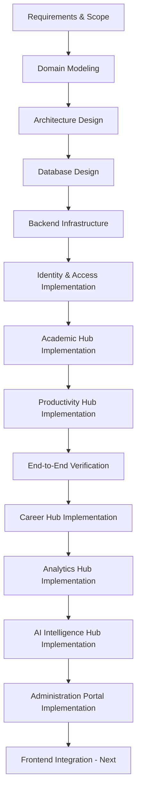

### What Comes Next?

All backend core hubs, gap closures, and the **Administration Portal** are fully implemented and verified. The next major milestone is **Frontend Integration**.

### Current Status
| Area | Status |
| :--- | :--- |
| **Requirements & Scope** | ‚úÖ Complete |
| **Domain Model & Architecture** | ‚úÖ Complete |
| **PostgreSQL Database** | ‚úÖ Complete |
| **Backend Infrastructure** | ‚úÖ Complete |
| **Identity & Access Module** | ‚úÖ Complete |
| **Academic Hub** | ‚úÖ Complete |
| **Productivity Hub** | ‚úÖ Complete |
| **Career Hub** | ‚úÖ Complete |
| **Analytics Hub** | ‚úÖ Complete |
| **AI Intelligence Hub** | ‚úÖ Complete |
| **Administration Portal** | ‚úÖ Complete |
| **Frontend Integration** | ‚è≥ Next |

### Project Roadmap

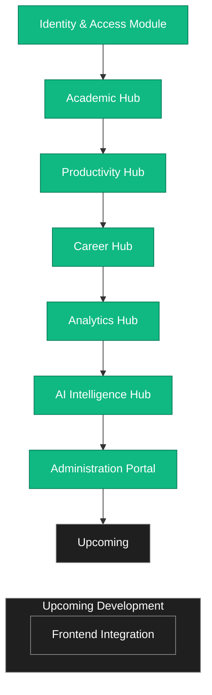

---

## 6. V1 Gap Closure — Systematic Audit & Remediation

> **Added 2026-08-20 / 2026-08-21** — After a full 105-functionality audit across all 26 features, we identified genuine backend gaps and systematically closed them in phases P1 through P5.

### 6.1 Audit Summary

| Result | Count |
|---|---|
| Fully implemented | 47 |
| Partial | 9 |
| Missing (real backend gaps) | ~23 (after removing 26 frontend/duplicate false positives) |

### 6.2 P1 — Identity & Access Gaps (commit `94fdb22`)

**What was missing and what we added:**

| # | Gap | What was built | Endpoint |
|---|---|---|---|
| I-1 | Forgot Password | Cryptographically random token, SHA-256 hash stored (not plaintext), 1-hour expiry, one-time use, generic response (no account enumeration) | `POST /auth/forgot-password`, `POST /auth/reset-password` |
| I-2 | Email Verification | Secure token, expiry, one-time use, resend capability, `isVerified` updated only on success | `POST /auth/verify-email`, `POST /auth/resend-verification` |
| I-3 | Update Profile | `PATCH /users/me` — firstName, lastName, university, enrollmentYear, graduationYear | `PATCH /users/me` |
| I-4 | Career Goals | `careerGoals String?` added to `StudentProfile` | Part of `PATCH /users/me` |
| I-5 | Social Links | `socialLinks Json?` added to `StudentProfile` (linkedin, github, portfolio, twitter) | Part of `PATCH /users/me` |
| I-6 | Upcoming Tasks | Filter: future-dated + not DONE, ordered by dueDate asc | `GET /tasks/upcoming` |

**Security decisions:**
- Reset tokens hashed with SHA-256 before DB storage — raw token only ever sent to user, never stored
- Forgot-password always returns the same message regardless of whether email exists, preventing account enumeration
- Email transport is development-grade (console log) — swap for Resend/SES in production without changing business logic

#### Verification
- [x] Forgot password: generic response confirmed (unknown email returns identical 200)
- [x] Reset password: token invalidated after use
- [x] Email verification: token one-time use confirmed
- [x] Profile update: careerGoals + socialLinks persisted and returned via GET /users/me
- [x] Upcoming tasks: DONE tasks excluded, past-due tasks excluded, ordering by dueDate confirmed
- [x] Cross-user task isolation: Student B cannot read or modify Student A's tasks

### 6.3 P2 — Academic Hub Gaps (commit `94fdb22`)

| # | Gap | What was built | Notes |
|---|---|---|---|
| A-1 | Task Priority | `priority Priority @default(MEDIUM)` on `Task` — reused existing `Priority` enum | `createTaskSchema` and `updateTaskSchema` updated |
| A-3 | Attendance Goal | `attendanceGoal Float?` on `Subject` (0–100%) | Validates 0–100 in Zod |
| A-4 | Attendance Report | Per-subject stats: totalClasses, attendedClasses, absentClasses, attendancePercentage, goal, goalDelta | `GET /attendance/report` |

**Bugfix discovered during P2:**
- `attendance.controller.ts` was using `req.user?.studentProfileId` (always `undefined`) instead of `req.user?.studentProfile?.id`. All five CRUD handlers were silently failing for ownership checks. Fixed to use the correct access pattern.

**Schema migration:** `20260820114243_v1_core_gaps_identity_academic`

Fields added to `User`: `passwordResetTokenHash`, `passwordResetExpires`, `verificationTokenHash`, `verificationExpires`  
Fields added to `StudentProfile`: `careerGoals`, `socialLinks`  
Fields added to `Subject`: `attendanceGoal`  
Fields added to `Task`: `priority`

#### Verification
- [x] Task priority: stored, returned, updated via PATCH
- [x] Upcoming tasks: correctly filters by dueDate > now AND status != DONE
- [x] Attendance goal: stored on Subject, returned in report
- [x] Attendance report: percentage, goal delta calculated correctly
- [x] Cross-user attendance isolation confirmed

### 6.4 P3 — Career Hub Gaps (commit `c0b3455`)

| # | Gap | What was built | Endpoint |
|---|---|---|---|
| C-1 | Resume Templates | `templateId String?` on `ResumeVersion`; 5 templates (classic/modern/minimal/executive/compact); changing template creates a new version | `GET /resumes/templates` |
| C-2 | Resume PDF Export | Returns structured JSON payload (templateId, content, versionId, atsScore, generatedAt) ready for a PDF rendering library | `GET /resumes/:id/pdf` |
| C-3 | Certifications | New `Certification` model — name, issuer, dateObtained, expiryDate, credentialId, credentialUrl | Full CRUD: `/certifications/*` |
| C-4 | Personal Projects | New `Project` model — title, description, technologies[], projectUrl, repoUrl, startDate, endDate, isOngoing | Full CRUD: `/projects/*` |
| C-5 | Interview Schedule | `interviewDate DateTime?` + `interviewRound String?` added to `JobApplication` | Part of `/job-applications/*` |
| C-6 | Offer Details | `offerDetails Json?` (salary, currency, benefits, deadline, notes) added to `JobApplication` | Part of `/job-applications/*` |

**Schema migration:** `20260821142706_v1_career_hub_p3`

New models: `Certification`, `Project`  
Modified: `ResumeVersion` (templateId), `JobApplication` (interviewDate, interviewRound, offerDetails)  
Relations added to `StudentProfile`: `certifications[]`, `projects[]`

#### Verification
- [x] Template list returns 5 templates
- [x] Resume created with templateId stored on version
- [x] Template switch creates new version, does not overwrite existing
- [x] PDF export data contains templateId, versionId, content, generatedAt
- [x] Cross-user PDF export blocked (404)
- [x] Certification CRUD: name, issuer, expiryDate stored and returned
- [x] Cross-user certification access blocked (404)
- [x] Project CRUD: technologies[] stored as array, isOngoing flag works
- [x] Cross-user project deletion blocked (404)
- [x] Interview date + round stored on job application
- [x] Offer details (salary, currency, benefits, deadline) stored as JSON
- [x] Cross-user job application access blocked (404)

### 6.5 P4 — Productivity Verification (commit `c0b3455`)

**Verification question:** Can certification renewal reminders be represented by the existing `Reminder` model, or do we need a new one?

**Answer:** Yes — the existing Reminder model is sufficient. The `GET /certifications/expiring?days=N` endpoint surfaces certifications nearing expiry. The frontend (or a background job) can use this to create Reminders via `POST /reminders` without any new backend model.

#### Verification
- [x] `GET /certifications/expiring?days=30` returns only certs with expiryDate > now AND <= now+30d
- [x] Certs with expiryDate > 30 days from now correctly excluded from the window
- [x] Generic Reminder model confirmed sufficient for renewal use case

### 6.6 P5 — Stabilization Checkpoint (commit `df9ea54`, pushed)

- [x] Full regression: `test-p1-p2.ts` — all assertions pass
- [x] Full regression: `test-p3-p4.ts` — all assertions pass
- [x] Prisma migrations reviewed: 4 migrations, clean history
- [x] API ownership/security reviewed: all data access gated at WHERE studentProfileId = authenticatedStudent
- [x] AI integration confirmed unaffected by resume schema changes (templateId is additive, not breaking)
- [x] `PROJECT_PROGRESS.md` updated (this section)
- [x] Committed and pushed to `main` on GitHub

### 6.7 What comes next (post P5)

```text
P1 Identity & Access         ‚úÖ done
P2 Academic Hub              ‚úÖ done
P3 Career Hub (C-1 ‚Üí C-6)   ‚úÖ done
P4 Productivity verification ‚úÖ done
P5 Regression + Push         ‚úÖ done

        ‚Üì

AI Notes Assistant           ‚úÖ done (see 6.8 below)
Analytics gaps               ‚úÖ done (see 6.9 below)
Administration Portal        ‚Üê next major module
Frontend Integration         ‚Üê major final phase
```

The Administration Portal is intentionally deferred because it consumes data produced by the rest of the platform. Building it before the student-facing domain is complete would mean repeatedly changing its statistics endpoints and management screens as underlying data evolves.

---

### 6.8 AI Notes Assistant — N1 through N5 (commit `45c21b9`)

**What was built:** Four AI-powered capabilities operating on a student's existing note content.

| Capability | Endpoint | Output |
|---|---|---|
| N1 Content extraction | Internal helper | `NoteContent` struct with ownership verification |
| N2 Summarization | `POST /ai/notes/:id/summarize` | `{ summary, keyPoints: string[] }` |
| N3 Key Point Extraction | `POST /ai/notes/:id/key-points` | `{ keyPoints: [{ point, importance: HIGH\|MEDIUM\|LOW }] }` |
| N4 Question Generation | `POST /ai/notes/:id/questions` | `{ questions: [{ question, answer, difficulty: EASY\|MEDIUM\|HARD }] }` |
| N5 Flashcard Generation | `POST /ai/notes/:id/flashcards` | `{ flashcards: [{ front, back }] }` |

**Architecture decisions made:**
- `AIModule.NOTES` already existed in schema — no migration needed
- Shared `executeNoteAI<T>()` helper eliminates RUNNING‚Üíprovider‚ÜíZod‚ÜíSUCCESS/FAILED repetition across all four capabilities
- File-only notes (no textual `content`) return 400 — document extraction deferred to future slice
- All error handling uses `catch (error: unknown)` — no `any` types anywhere in AI layer
- MockProvider is deterministic (test-only); GeminiProvider is production

**Bugfix included:** `note.controller.ts` was using `req.user?.studentProfileId` (always `undefined`) — same pattern as the `attendance.controller.ts` bug fixed in P2. Fixed to `req.user?.studentProfile?.id` via `getProfileId()` helper.

**Verification:** `scripts/test-ai-notes.ts` — 10 assertions covering all four capabilities, file-only 400 edge case, cross-user isolation (404), unauthenticated rejection (401). All pass with mock provider. Manual Gemini verification step documented in test output.

---

### 6.9 Analytics Gaps (AN-1, AN-2, AN-3) (commit `036fd5e`)

**What was built:** Three new analytics endpoints extending the existing dashboard.

| Gap | Endpoint | What it returns |
|---|---|---|
| AN-1 Skills Progress | `GET /analytics/skills-progress` | `totalSkills`, `averageProficiency`, `byCategory` (count, avgProficiency, skills[]) |
| AN-2 Placement Readiness | `GET /analytics/placement-readiness` | Heuristic score 0–100 with breakdown and recommendations |
| AN-3 Activity Breakdown | `GET /analytics/activity?period=daily\|weekly\|custom` | Tasks completed + attendance stats for time window |

**Design notes:**
- **AN-2 is documented as a heuristic**, not a validated employability metric. Weights (Skills 25%, Resume ATS 25%, Applications 20%, Certs 15%, Projects 15%) are product-defined and disclosed to API consumers via a `note` field in the response.
- **AN-3 custom range is validated by Zod `superRefine`**: `period=custom` requires both `startDate` and `endDate`, and `startDate` must be ≤ `endDate`. Invalid ranges return 400 instead of silently defaulting.
- **AN-3 tasks use `updatedAt` as a proxy for completion time** — documented as a known limitation in code comments. A future `Task.completedAt` migration would remove the ambiguity.
- No `req.query as any` anywhere — activity query is typed via `ActivityQuery` from `analytics.schema.ts`.

**Verification:** `scripts/test-analytics.ts` — dashboard regression + AN-1/AN-2/AN-3 assertions including custom range validation (missing endDate → 400, inverted range → 400). All pass.

### 6.10 Full Regression Summary (post AI Notes + Analytics)

```text
test-p1-p2.ts    ‚úÖ  Identity & Access + Academic gaps
test-p3-p4.ts    ‚úÖ  Career Hub + Productivity verification
test-ai-notes.ts ✅  AI Notes Assistant (N2–N5)
test-analytics.ts ‚úÖ  Dashboard regression + AN-1, AN-2, AN-3
```

All four suites pass with zero failures. Working tree clean. Pushed to `main`.

### 6.11 Transition to Administration Portal

```text
AI Notes Assistant           ‚úÖ done
Analytics gaps (AN-1–AN-3)   ✅ done
Administration Portal        ‚úÖ done (see Section 7)

        ‚Üì

Frontend Integration         ‚Üê major next phase
```

The backend is now fully complete across all core student hubs, AI integrations, analytics capabilities, and the complete institutional administration portal.

---

## 7. Administration Portal Implementation (Phases A1 – A7.1)

**Status:** ‚úÖ Complete & Verified

The Administration Portal provides institutional oversight, academic catalog governance, content broadcasting, platform monitoring, and telemetry across **20 promised functionalities** (4 per feature across User Management, Academic Management, Content Management, Platform Management, and Reporting). It operates parallel to the student platform with strict role separation and complete auditability.

### 7.1 Architecture & Schema Foundation (A1)
- **Catalog Separation:** Separated institutional master catalog (`Department` ‚Üí `Course` ‚Üí `MasterSubject`, `AcademicTerm`) from student personal operational entities (`Semester`, `Subject`).
- **Targeted Content Models:** Scoped `Announcement`, `InstitutionalEvent`, and `AcademicResource` supporting `ALL`, `DEPARTMENT`, and `COURSE` scopes.
- **Audit & Governance:** Append-only, tamper-evident `AdminAuditLog` recording actor, action, target, JSON metadata diffs, and IP addresses.
- **Dynamic Configuration:** `SystemSetting` table for runtime feature toggling without service redeployment.
- **Schema Migration:** `20260824093648_add_admin_portal_schema` (10 new models, clean rollback compatibility).

### 7.2 Core Administration Subsystems (A2 – A6)
1. **User Management (A2):**
   - Paginated student and administrator directory with query filtering (`isActive`, `isVerified`, search) and zero password/token hash exposure.
   - Account status lifecycle (Ban / Reactivation) with self-lockout prevention and last-admin protection.
   - Bidirectional role transitions (`STUDENT` ‚Üî `ADMIN`) with guaranteed data preservation (demoted admins retain baseline student entities; promoted students keep existing student records).
2. **Academic Catalog Management (A3):**
   - Hierarchical CRUD for Departments, Courses, Master Subjects, and Academic Terms.
   - Restrictive deletion safety guards (cannot delete departments with courses, courses with subjects/enrolled students, or master subjects with student references).
   - Public authenticated student catalog feeds (`/api/v1/catalog/*`).
3. **Institutional Content Management (A4):**
   - Announcements & Notices draft/publish lifecycle with expiry auto-hiding.
   - Institutional Event scheduling and Academic Resource distribution.
   - Scoped Student Content Feeds (`/api/v1/content/*`) delivering targeted materials based on department and course enrollment.
4. **Platform Oversight & Feedback (A5):**
   - Admin Dashboard real-time KPI aggregations.
   - Searchable, paginated append-only audit trail viewer.
   - Two-sided feedback resolution workflow (`PENDING` ‚Üí `UNDER_REVIEW` ‚Üí `RESOLVED` / `DISMISSED`).
   - Dynamic system setting enforcement: `MAINTENANCE_MODE` (HTTP 503 for students, admins bypassed), `ALLOW_STUDENT_REGISTRATION` (HTTP 403 on signup), `AI_FEATURES_ENABLED` (HTTP 403 on AI endpoints).
5. **Reporting & Telemetry (A6):**
   - User growth and active rates by period (daily, weekly, monthly).
   - Academic attendance and performance distributions.
   - AI execution metrics and career application pipelines.
   - Platform health, runtime memory, and database latency telemetry.
   - Strict read-only guarantee (zero audit log pollution on report access).

### 7.3 Verification & Test Coverage (A7)
All 11 test suites pass with 100% green status:
- [x] `test-admin-foundation.ts` — Auth, RBAC, ping, schema checks
- [x] `test-admin-users.ts` — User directory, status toggling, role transitions, audit logs
- [x] `test-admin-academics.ts` — Academic CRUD, deletion guards, catalog feeds, student hub autonomy
- [x] `test-admin-content.ts` — Announcement lifecycle, scoping, events, resources, student feeds
- [x] `test-admin-platform.ts` — Dashboard metrics, audit log search, feedback loop, system setting toggles
- [x] `test-admin-reports.ts` — User, academic, usage reports, platform health telemetry
- [x] `test-admin.ts` — Full cross-module administration E2E suite
- [x] `test-p1-p2.ts` — Identity & Access + Academic gap regressions
- [x] `test-p3-p4.ts` — Career Hub + Productivity regressions
- [x] `test-ai-notes.ts` — AI Notes assistant regressions
- [x] `test-analytics.ts` — Multi-dimensional analytics regressions

### 7.4 Type Safety & Documentation Stabilization Checkpoint (A7.1)
- [x] **Zero TypeScript Suppressions:** All `@ts-nocheck`, `@ts-ignore`, and `@ts-expect-error` comments completely eliminated across the entire backend.
- [x] **Strict Compiler Compliance:** Full strictness preserved in `backend/tsconfig.json` (`exactOptionalPropertyTypes: true`, `noUncheckedIndexedAccess: true`, `strict: true`).
- [x] **Clean Static Type Check:** `npx prisma validate && npx prisma generate && npx tsc --noEmit` exits with **0 errors**.
- [x] **Clean Repository State:** Zero temporary test artifacts or untracked secret files. Ready for frontend integration.

---

## 8. Backend V1 Closure ó Session Log (2026-08-29 ? 2026-09-11)

> **Branch:** `backend/v1-closure` | **Baseline:** `c176d31` (main) | **Remote:** pushed to `origin/backend/v1-closure`

### 8.1 Session Objective

After permanently freezing the Administration Portal (A1ñA7, 20/20 functionalities), a full-project audit identified six backend gaps (G1ñG6) that existed between the approved product synopsis and the implemented backend. This session began executing the approved **Backend V1 Closure Plan v2** to close all six gaps before frontend development starts.

The plan was executed using the Subagent-Driven Development (SDD) workflow: one implementer subagent per task ? task reviewer gate ? ledger update ? next task.

---

### 8.2 Completed This Session (Tasks 1ñ5 of 9)

| Task | Commit | Description | Tests |
|------|--------|-------------|-------|
| T1 ó Storage Provider Infrastructure | `b42d73c` | `StorageProvider` interface, `LocalStorageProvider` (writes to `backend/uploads/`), `SupabaseStorageProvider` (private bucket), `getStorageProvider()` factory. New env vars: `STORAGE_PROVIDER`, `SUPABASE_URL`, `SUPABASE_SERVICE_KEY`. | Smoke-tested inline |
| T2 ó Production Hardening | `a0080e5` | Rate limiting (`globalLimiter` 200/15min, `authLimiter` 10/15min, `uploadLimiter` 20/15min ó active in production). Body limit capped at 256 KB. `compression()` middleware. `trust proxy 1`. Graceful SIGTERM/SIGINT shutdown with `prisma.$disconnect()`. 30-second timeout on all Gemini AI calls. Email abstraction (`emailService.send()`). Critical `errorHandler` bug fixed: unknown errors no longer leak `err.message` to clients ó returns `'Internal Server Error'`. | test-admin-foundation ? |
| T3 ó Notes File Upload (G1) | `72d93db` | `POST /api/v1/notes/:noteId/upload` ó multipart PDF/DOCX/PPT/PPTX upload (max 10 MB), magic-byte validated via `file-type`, ownership checked, stored via StorageProvider, `fileId` saved on `Note`. `GET /api/v1/notes/:noteId/file` ó returns 302 signed-URL redirect. Prisma migration: `Note.fileId String?`. | test-notes-upload 7/7 ? |
| T4 ó Student Profile Resume Upload (G2) | `26a7bae` | `POST /api/v1/users/me/resume-upload` ó PDF-only upload (magic-byte validated), profile existence checked before storage, `uploadedResumeFileId` saved on `StudentProfile`. `GET /api/v1/users/me/resume-file` ó 302 redirect. Prisma migration: `StudentProfile.uploadedResumeFileId String?`. | test-profile-resume-upload 6/6 ? |
| T5 ó Resume PDF Binary Export (G3) | `35ff0ad` | `GET /api/v1/resumes/:id/pdf` now returns `Content-Type: application/pdf` binary (first bytes: `%PDF`). PDFKit renderer in `backend/src/utils/pdf/pdf.renderer.ts` renders all 5 templates (classic/modern/minimal/executive/compact) with personalInfo, education, experience, skills, projects sections. Ownership enforced. Previous JSON-returning handler replaced. | test-resume-pdf-export 7/7 ? |

**All 5 committed tasks passed their task reviewer gates (Spec: PASS, Quality: Approved).**

---

### 8.3 Remaining Work (Tasks 6ñ9 ó NOT YET STARTED)

| Task | Gap | What It Does |
|------|-----|-------------|
| T6 ó Career Hub Discriminator | G4 | Add `applicationType (INTERNSHIP\|PLACEMENT)`, `eligibilityStatus (UNKNOWN\|ELIGIBLE\|NOT_ELIGIBLE)`, `interviewHistory Json?` to `JobApplication`. New filter routes: `GET /internships`, `GET /placements`. |
| T7 ó Analytics Canonical Computations | G5 | Four new analytics: per-subject attendance/assignment breakdown (`GET /analytics/subject-performance`), resume completion score (in dashboard), internship-only stats (`GET /analytics/internship-stats`), study-plan goal achievement rate (in dashboard). **Depends on T6.** |
| T8 ó AI Study Planner Extension | G6 | Extend `GeneratedStudyPlan` with `weeklySchedule[]`, `revisionPlan[]`, `topicPriorities[]`, `goalRecommendations[]`. Update Gemini schema + prompt + mock provider. |
| T9 ó Production Build + Audit + Documentation | ó | `npm run build` exits 0. `dist/server.js` runs. `npm audit --production` = 0 HIGH/CRITICAL. `test-production-hardening.ts` passes. `PROJECT_PROGRESS.md` final update. |

---

### 8.4 SDD Ledger ó Deferred Minor Findings

These were flagged by task reviewers but do not block correctness or security. They are parked for the final whole-branch review (Task 9 / final reviewer):

| Task | Finding |
|------|---------|
| T2 | `withTimeout` timer not `unref()`'d on Gemini resolution ó minor event-loop leak |
| T2 | `withTimeout` attaches `statusCode` but `handleGeminiError` checks `err.status` ó timeout falls to generic 500 |
| T3 | `uploadNoteFile` calls `provider.upload()` before ownership verification ó orphaned file on invalid noteId |
| T4 | Re-upload overwrites `uploadedResumeFileId` without deleting prior file from storage |

---

### 8.5 Branch State for Handoff

```
branch:   backend/v1-closure
HEAD:     35ff0ad
remote:   origin/backend/v1-closure (pushed)
tsc:      0 errors (verified at each task)
prisma:   migrations applied (add_note_file_id, add_student_profile_uploaded_resume)
tests:    test-notes-upload (7/7), test-profile-resume-upload (6/6), test-resume-pdf-export (7/7)
          + all 11 original administration/regression suites still passing
gaps:     G1 ?  G2 ?  G3 ?  G4 ?  G5 ?  G6 ?
```

**Next session start point:** Execute Task 6 (Career Hub Discriminator) from the `backend/v1-closure` worktree at `d:\ALL_PROJECTS\integrum\.worktrees\backend-v1-closure`. The SDD execution plan is at `docs/superpowers/plans/2026-08-29-backend-v1-closure.md` inside the worktree.


## Backend closure continuation — 19 September 2026

Local implementation branch: `fix/backend-closure-day1`. T6 career classification, T7 analytics, and T8 expanded AI study-plan output are implemented with regression checks. T9 is **in progress, not passed**: full workspace build and compiled production-server checks are addressed, but four high dependency findings and remaining session/email/storage/environment gates prevent final backend freeze. See `BACKEND_CLOSURE_DAY1.md` for current evidence, API contracts, and outstanding work; older completion claims above are historical.

Publishing is deferred until remaining security checks complete. After merging into main, retain existing branches without further commits; do not delete or prune them.


### Dependency audit checkpoint - 20 September 2026

Production dependency audit now reports zero vulnerabilities after retaining Prisma 7.10.0 at the workspace root and applying documented deepmerge-ts/mysql2 overrides. Clean installation, Prisma configuration/schema/client tooling, full build, 20 closure tests and compiled production smoke passed. See BACKEND_CLOSURE_DAY1.md for evidence and override maintenance requirements. T9 remains open for data-integrity and native PostgreSQL/live-service verification; do not interpret this as final backend freeze.

Dependency remediation final verification: full root build, strict test compilation, 20 closure tests, compiled production smoke and all 14 baseline regression scripts passed. Production dependency audit: zero findings. Database suites used isolated PGlite with all 12 migrations; native PostgreSQL and live-service gates remain open. Changes remain local pending the remaining security checks.

T9 attendance integrity: record mutations and totals now commit atomically under a per-subject lock shared with subject PATCH. Reject impossible totals (400) and silent mixing of manual totals with individual records (409). Preserve PRESENT/LATE and EXCUSED counting semantics. New rollback/ownership/concurrency coverage added; final results follow in BACKEND_CLOSURE_DAY1.md. Native PostgreSQL concurrency and remaining data/environment gates are still open.

Attendance final verification: backend build, strict test compilation, all 22 closure tests, compiled production smoke, and three affected legacy suites (test-p1-p2, test-analytics, test-admin-academics) passed on isolated PGlite. Next: institutional linkage and report filtering; native PostgreSQL/live-environment verification remains outstanding.

T9 report filters: user totals/breakdowns now share date and institutional scope; usage validates/applies enrollment filters; academic windows filter attendance dates and assignment creation dates, excluding undated manual totals with response metadata. UTC trends and career creation-date monthly attribution fixed. Institutional write journeys and native/live-service gates remain open. See BACKEND_CLOSURE_DAY1.md for API semantics and verification.

Report-filter final verification: 23 closure tests plus compiled production smoke passed under a non-UTC timezone; existing admin-report regression passed. Backend build and strict test compilation passed. All changes remain local. Next: institutional enrollment and academic linkage write journeys.

T9 academic-term linkage: added student active-term lookup and optional semester academicTermId linking/unlinking; preserved inactive historical links. Merged-date validation and row locking protect semester edits and term deletion/reference checks. Student course enrollment and master-subject linkage remain open. Verification follows in BACKEND_CLOSURE_DAY1.md.

Term-linking checkpoint: new term tests, build/typecheck, admin-academics and p1-p2 regressions passed; compiled production smoke passed independently. Full closure suite is NOT green: failed-attachment storage regression recurred (22 pass, 2 fail including parent suite). Added semester compare-and-set to reject stale edits. Next priority is storage diagnosis before course/master-subject linkage.

Storage investigation checkpoint: trace confirmed failed-upload cleanup executed; an older deleted object later reappeared without a second upload call. Two standalone filesystem probes (100 cycles each) passed. The unchanged full suite run without concurrent workspace commands passed all 24 tests plus compiled production smoke. Execution-environment interference is a hypothesis, not a proven cause; native filesystem/PostgreSQL verification stays open. No speculative storage fix or weakened assertion was introduced. Term-linking code: df6d176.

T9 course enrollment: admin-only PATCH /admin/users/:id/enrollment supports validated assignment/unenrollment with atomic audit, stale-write detection and incompatible syllabus-link protection. Student profile exposes course/department metadata. Build/typecheck, 25 closure tests, compiled production smoke and admin-users/admin-academics/admin-reports regressions passed sequentially on isolated PGlite. Next: master-subject lookup/linking. Native/live-service and storage verification limits remain open; no publishing.
