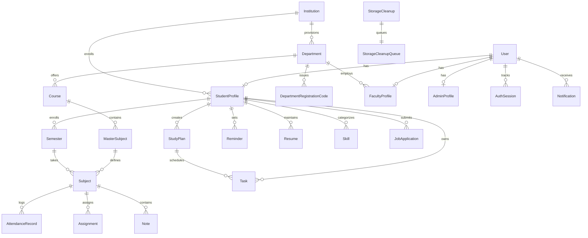

# Database Architecture: Integrum

Integrum utilizes a PostgreSQL relational database managed through Prisma ORM 7 (`@prisma/client@^7.9.1`, `@prisma/adapter-pg`). The schema models multi-tenant institutional governance, locked academic curricula, student productivity, and career acceleration.

---

## 1. Relational Entity Overview



---

## 2. Design Conventions & Invariants

1. **Primary Keys:** Standardized on UUID v4 (`String @id @default(uuid())`) across all operational and catalog entities for distributed safety.
2. **Timestamps:** Every mutable entity includes `createdAt DateTime @default(now())` and `updatedAt DateTime @updatedAt`.
3. **Cascade Rules:**
   - **`onDelete: Cascade`** is enforced on operational sub-resources owned exclusively by a parent (e.g. `Subject -> AttendanceRecord`, `StudentProfile -> Tasks`, `User -> StudentProfile`, `Resume -> ResumeVersion`).
   - **`onDelete: Restrict`** is enforced on administrative catalogs, audit trails, and master curriculums (e.g. `Course -> Department`, `Announcement -> Author User`, `AdminAuditLog -> Actor User`) to prevent accidental cascade destruction of institutional records.
   - **`onDelete: SetNull`** is applied to optional associations (e.g. `StudentProfile -> Course`, `Subject -> MasterSubject`).
4. **Idempotency & Uniqueness:**
   - Unique constraints guard against double-submissions: `StudyPlan(studentProfileId, idempotencyKey)`, `MasterSubject(courseId, code)`, `DepartmentRegistrationCode(code)`.
   - Reminder scheduling prevents duplicate triggers via `Reminder(studentProfileId, sourceType, sourceId, occurrenceKey)`.

---

## 3. Data Dictionary by Functional Domain

### A. Identity, Access & Profiles

| Model | Primary Key | Description | Key Indexes / Constraints |
|---|---|---|---|
| **`User`** | `id` (UUID) | Master authentication entity with hashed credentials, email verification, and `authVersion`. | `email` (Unique), `authVersion` |
| **`AuthSession`** | `id` (UUID) | Active refresh token session store with token hashing and expiration tracking. | `userId` (Index) |
| **`StudentProfile`** | `id` (UUID) | Student profile metadata, roll number, academic program, and independent learner flag. | `userId` (Unique, FK -> User) |
| **`FacultyProfile`** | `id` (UUID) | Faculty lecturer profile, department assignment, designation, and specialization. | `userId` (Unique, FK -> User) |
| **`AdminProfile`** | `id` (UUID) | Campus and department administrator profile with permission levels (1–3). | `userId` (Unique, FK -> User) |
| **`StudentSettings`**| `id` (UUID) | Student notification preferences and default active semester reference. | `userId` (Unique, FK -> User) |
| **`Notification`** | `id` (UUID) | System, AI, exam, and announcement push notifications. | `userId` (FK -> User) |

### B. Multi-Tenant Campus Catalog (Admin Owned)

| Model | Primary Key | Description | Key Indexes / Constraints |
|---|---|---|---|
| **`Institution`** | `id` (UUID) | University/college campus entity, accreditation info, and master admin binding. | `name` (Unique), `code` (Unique) |
| **`Department`** | `id` (UUID) | Academic department (CSE, IT, MECH) linked to an Institution. | `name` (Unique), `code` (Unique) |
| **`DepartmentRegistrationCode`** | `id` (UUID) | Dynamic admission code (e.g. `CSE-2026-S5`) locked to semester, year, and max uses. | `code` (Unique) |
| **`Course`** | `id` (UUID) | Academic degree program (e.g. `BTECH_CSE`, 4 years, 8 semesters). | `code` (Unique), `departmentId` (FK) |
| **`MasterSubject`** | `id` (UUID) | Master syllabus course definition with credit allocation and semester number. | `(courseId, code)` (Unique) |
| **`AcademicTerm`** | `id` (UUID) | Institutional academic term calendar (Odd, Even, Summer) with start/end dates. | `academicYear`, `termType` |

### C. Student Academic Hub (Operational)

| Model | Primary Key | Description | Key Indexes / Constraints |
|---|---|---|---|
| **`Semester`** | `id` (UUID) | Student's active or archived semester instance, linked to an AcademicTerm. | `studentProfileId` (FK) |
| **`Subject`** | `id` (UUID) | Enrolled course instance with attendance counters (`totalClasses`, `attendedClasses`). | `semesterId` (FK) |
| **`AttendanceRecord`**| `id` (UUID) | Class-by-class attendance logs (Present, Absent, Late, Excused). | `subjectId` (FK) |
| **`Assignment`** | `id` (UUID) | Coursework deliverables, priority levels, and submission/grading status. | `subjectId` (FK) |
| **`Note`** | `id` (UUID) | Rich markdown notes with file attachments and storage provider bindings. | `subjectId` (FK) |
| **`StudyPlan`** | `id` (UUID) | AI-generated exam preparation roadmaps with target dates and progress gauges. | `(studentProfileId, idempotencyKey)` (Unique) |

### D. Productivity & Career Hub

| Model | Primary Key | Description | Key Indexes / Constraints |
|---|---|---|---|
| **`Task`** | `id` (UUID) | Personal tasks and AI-generated study sessions (Todo, In Progress, Done). | `studentProfileId` (FK), `studyPlanId` (FK) |
| **`Reminder`** | `id` (UUID) | Scheduled event triggers with delivery status tracking. | `(studentProfileId, sourceType, sourceId, occurrenceKey)` (Unique), `(triggerAt, deliveryStatus)` (Index) |
| **`Resume`** | `id` (UUID) | Student resume document profile with active version toggle. | `studentProfileId` (FK) |
| **`ResumeVersion`** | `id` (UUID) | Immutable version snapshot storing structured JSON content, template ID, and ATS score. | `resumeId` (FK) |
| **`Skill`** | `id` (UUID) | Technical and soft skills with 1–5 proficiency rating. | `studentProfileId` (FK) |
| **`JobApplication`** | `id` (UUID) | Internship and placement pipeline tracking (Applied, Interviewing, Offered, Rejected). | `studentProfileId` (FK) |
| **`Certification`** | `id` (UUID) | Professional credentials with issuance dates and expiry reminder triggers. | `studentProfileId` (FK) |
| **`Project`** | `id` (UUID) | Technical portfolio projects with technology tag arrays and repository links. | `studentProfileId` (FK) |
| **`StudentAnalytics`**| `id` (UUID) | Precomputed metrics: attendance percentage, task completion, average ATS score. | `studentProfileId` (Unique) |

### E. Governance, Audit & Infrastructure

| Model | Primary Key | Description | Key Indexes / Constraints |
|---|---|---|---|
| **`Announcement`** | `id` (UUID) | Official notices with scoped targeting (`ALL`, `DEPARTMENT`, `COURSE`). | `authorUserId` (FK), `isPublished` |
| **`InstitutionalEvent`**| `id` (UUID) | Academic calendar events (Exams, Holidays, Seminars, Workshops). | `createdByUserId` (FK) |
| **`AcademicResource`**| `id` (UUID) | Downloadable syllabi, previous exam papers, and study guides. | `uploadedByUserId` (FK) |
| **`AdminAuditLog`** | `id` (UUID) | Immutable ledger of administrative mutations (actor, target, diff JSON, IP). | `actorUserId` (FK), `createdAt` (Index) |
| **`SystemSetting`** | `id` (UUID) | Global platform controls (Maintenance Mode, AI Feature Switches). | `key` (Unique Enum) |
| **`StorageCleanup`** | `fileId` (String)| Asynchronous queue tracking deleted files requiring remote storage purging. | `fileId` (PK), `attempts` |

---

## 4. Multi-Tenant Data Isolation Strategy

Integrum enforces tenant isolation at two coordinated layers:

1. **Service-Level Prisma Scoping (Application Layer):**
   - All student routes (`/api/v1/semesters`, `/api/v1/tasks`, `/api/v1/notes`, etc.) unconditionally scope database queries to the authenticated session's `studentProfileId`:
     ```typescript
     // Example invariant enforced in all controllers
     const tasks = await prisma.task.findMany({
       where: { studentProfileId: req.user.studentProfile.id }
     });
     ```
   - Faculty members can only mark attendance and view rosters for courses within their assigned `departmentId`.
   - Department Heads and Admins can only view and modify records matching their institution and department.
2. **Database Row-Level Security (Supabase Layer):**
   - For environments utilizing direct Supabase Client access, Row-Level Security (RLS) is enabled with `DEFAULT DENY`.
   - Queries through the Express backend authenticate via a secure service role connection using pooled connection strings.

---

## 5. Storage Cleanup Subsystem

To eliminate orphaned storage blobs when notes or avatars are deleted:
1. Deleting a record with an associated file does not synchronously call third-party storage APIs (preventing slow requests or partial failures).
2. The transaction inserts an entry into `StorageCleanup`:
   ```prisma
   model StorageCleanup {
     fileId    String   @id
     provider  String   // "supabase" | "local"
     createdAt DateTime @default(now())
     attempts  Int      @default(0)
   }
   ```
3. A background cleanup worker (`scripts/retry-storage-cleanup.ts`) polls the queue, purges the remote blob via the appropriate storage adapter, and deletes the queue entry upon confirmed deletion.

---

## 6. Migration & Schema Evolution Discipline

1. **Version Control:** All database schema changes are stored as timestamped SQL migrations in `backend/prisma/migrations/`.
2. **No Manual Schema Modifications:** Modifying tables or columns directly in the PostgreSQL database console is strictly prohibited.
3. **Expand/Contract Pattern for Zero Downtime:**
   - Step 1 (Expand): Add new columns as optional/nullable.
   - Step 2 (Backfill): Run data backfill script.
   - Step 3 (Deploy): Deploy application code utilizing new columns.
   - Step 4 (Contract): Remove obsolete columns in a subsequent migration.
4. **Local & CI Verification:**
   - Generate Prisma client: `npm run db:generate` (`prisma generate`).
   - Deploy pending migrations: `npm run db:migrate` (`prisma migrate deploy`).
   - Seed test fixtures: `npm run seed` (`tsx prisma/seed.ts`).
